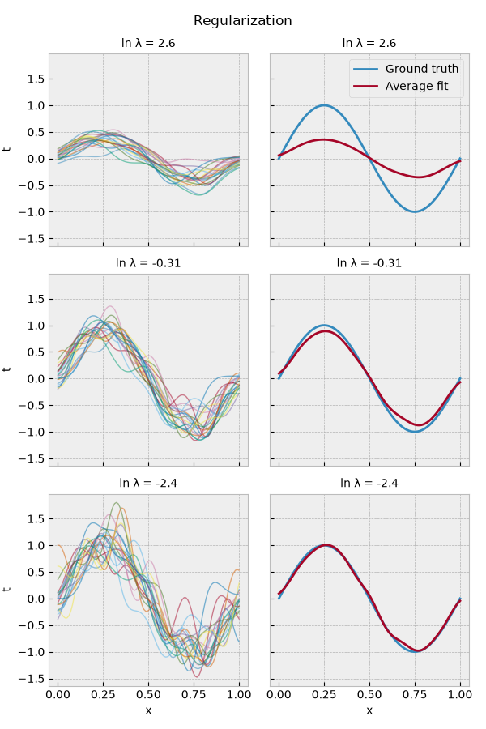
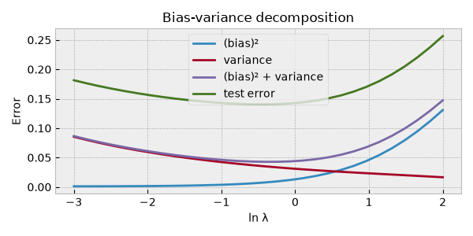

# Bias-Variance Decomposition

Minimal bias-variance decomposition of regularized linear regression, as introduced in *Pattern Recognition and \
Machine Learning* by Christopher M. Bishop, section 3.2.

## Foundations
- True function: $h(x) = \sin(2\pi x)$, targets $t = h(x) + \epsilon, \epsilon \sim \mathcal{N}(0, \sigma^2)$
- Model: $y(x, w) = w^\top \phi(x)$ with a bias and Gaussian basis functions $\phi_j(x) = \exp\left(-\frac{(x - \mu_j)^2}{2s^2}\right)$
- Regularized least squares: $w = (\lambda I + \Phi^\top \Phi)^{-1} \Phi^\top t$

Fitting the model to data sets $\mathcal{D}$ gives an average prediction $\bar{y}(x) = \mathbb{E}_\mathcal{D}[y(x; \mathcal{D})]$ and

$$\text{expected loss} = (\text{bias})^2 + \text{variance} + \text{noise}$$

- $(\text{bias})^2 = \int (\bar{y}(x) - h(x))^2 p(x) dx$: how far the average fit is from the true function
- $\text{variance} = \int \mathbb{E}_\mathcal{D}[(y(x; \mathcal{D}) - \bar{y}(x))^2] p(x) dx$: how much the fits scatter around their average
- $\text{noise} = \sigma^2$: irreducible error in the data

## Implementation
- NumPy only for the model (`bias_variance.py`)
- Run `python build.py` to generate the figures with Matplotlib; all settings are constants at the top of the script
- Setup: $L = 100$ data sets with $N = 25$ points each, 24 Gaussian basis functions of width $s = 0.05$ plus bias ($M = 25$), $\sigma = 0.3$, 1000 test points
- `pytest` checks that the regularized least squares fit matches scikit-learn's `Ridge`

## Results

### Regularization
Left: 20 of the 100 fits. Right: average of the 100 fits and the true function.

### Bias-variance trade-off

Interpretation: large $\lambda$ gives a stiff model with high bias and low variance; small $\lambda$ gives a flexible model
with low bias and high variance.
The minimum of the test error, $(\text{bias})^2 + \text{variance} + \sigma^2$, occurs at an intermediate $\lambda$ where bias and variance are balanced.
