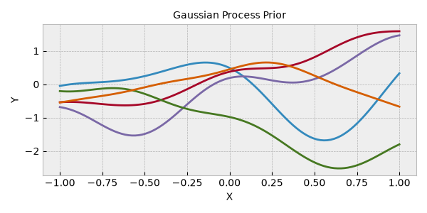
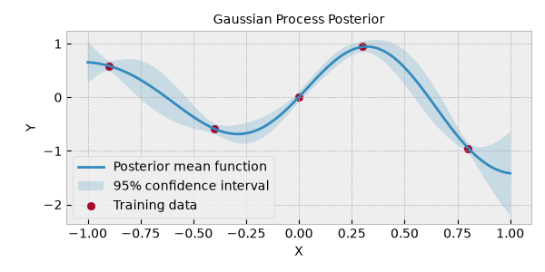

# Gaussian Process
Minimal Gaussian Process regression implementation, as introduced in *Pattern Recognition and Machine Learning* by \
Christopher M. Bishop, section 6.4.

## Foundations
- Prior: $f(x) \sim \mathcal{GP}(0, k(x, x'))$
- Radial basis function kernel $RBF$: $k(x, x') = \exp\left(-\frac{(x - x')^2}{2\ell^2}\right)$
- Noisy observations: $y = f(x) + \epsilon, \epsilon \sim \mathcal{N}(0, \sigma_n^2)$

For training inputs $X$ and test inputs $X_*$, define:
- $K = k(X, X)$: train-train kernel matrix $(n \times n)$
- $K_* = k(X, X_*)$: train-test cross-kernel matrix $(n \times m)$
- $K_{**} = k(X_*, X_*)$: test-test kernel matrix $(m \times m)$

Posterior predictive distribution at $X_*$:
- Posterior mean: $\mu_* = K_*^\top (K + \sigma_n^2 I)^{-1} y$
- Posterior covariance: $\Sigma_* = K_{**} - K_*^\top (K + \sigma_n^2 I)^{-1} K_*$
- Cost: $O(n^3)$ time and $O(n^2)$ memory, since $K$ must be factorized; this limits exact GPs to small datasets

## Implementation
- NumPy only for the GP (`gaussian_process.py`), with a Cholesky decomposition instead of explicit inversion
- Run `python build.py` to generate the figures with Matplotlib
- `pytest` checks that the kernel matrix is symmetric and positive semi-definite and that predictions match scikit-learn's `GaussianProcessRegressor`

## Results
Shown below are samples from the Gaussian Process prior and the posterior predictive distribution after observing data.

### Prior

### Posterior

Interpretation: mean = prediction, $\pm2\sigma$ band = uncertainty.

