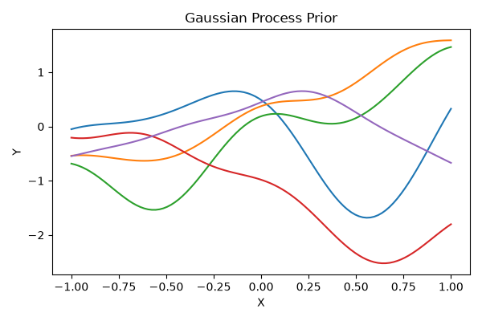
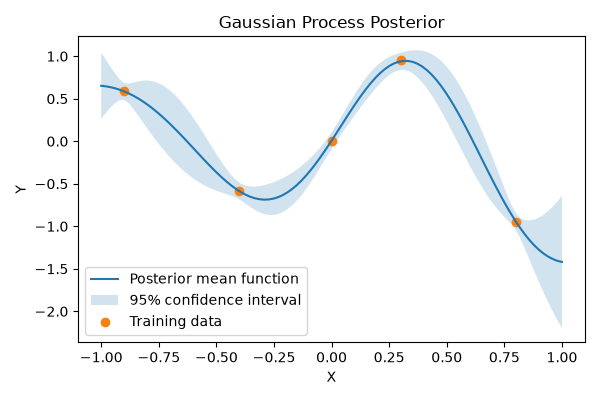

# Gaussian Process
Minimal Gaussian Process regression implementation, as introduced in *Pattern Recognition and Machine Learning* by \
Christopher M. Bishop, section 6.4.

## Run
`python build.py`

## Foundations
- Prior: $f(x) \sim \mathcal{GP}(0, k(x, x'))$
- Radial basis function kernel $RBF$: $k(x, x') = \exp\left(-\frac{(x - x')^2}{2\ell^2}\right)$
- Noisy observations: $y = f(x) + \epsilon, \epsilon \sim \mathcal{N}(0, \sigma_n^2)$

For training inputs $X$ and test inputs $X_*$, define:
- $K = k(X, X)$: train-train kernel matrix $(n \times n)$
- $K_* = k(X, X_*)$: train-test cross-kernel matrix $(n \times m)$
- $K_{**} = k(X_*, X_*)$: test-test kernel matrix $(m \times m)$

Posterior predictive distribution at $X_*$:
- Posterior mean: $\mu_* = K_*^\top (K + \sigma_n^2 I)^{-1} y$
- Posterior covariance: $\Sigma_* = K_{**} - K_*^\top (K + \sigma_n^2 I)^{-1} K_*$

## Implementation
This implementation uses:
- NumPy for linear algebra
- Cholesky decomposition to solve linear systems stably (instead of explicit inversion)
- Matplotlib for visualization

## Complexity
- Training: $O(n³)$
- Memory: $O(n²)$

The kernel matrix must be factorized during training,
which limits exact Gaussian Processes to small datasets.

## Results
Shown below are samples from the Gaussian Process prior and the posterior predictive distribution after observing data.

### Prior

### Posterior

Interpretation: mean = prediction, $\pm2\sigma$ band = uncertainty.

## Takeaways
- Gaussian Process regression is a non-parametric Bayesian approach to regression.
- Predictions include both a mean estimate and an uncertainty estimate.
- Uncertainty decreases near observations and increases away from data.
- The kernel encodes prior assumptions about smoothness.
- Computational cost scales cubically with the number of training samples.